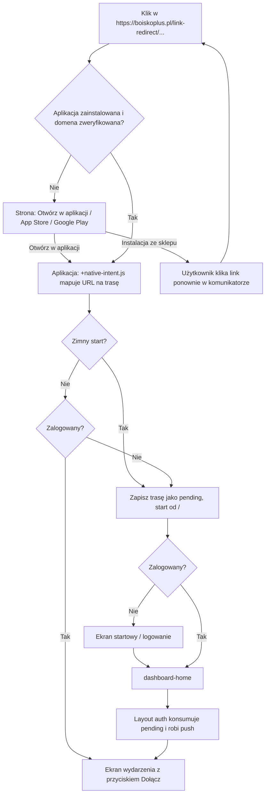

# PLAN — Linkowanie i zaproszenia do wydarzeń (Universal Links / App Links)

Data: 2026-10-29 (wersja 2, aktualizacja po `docs/infoForBuild.md`)
Status: Faza 1 (strona) wdrożona i zweryfikowana `curl` (2026-11-10). Faza 2 (serwer) w kodzie, niewdrożona. Faza 3 (aplikacja) w kodzie (2026-11-11), wymaga instalacji `expo-clipboard`, nowego buildu i testów na urządzeniu. Faza 4 (udostępnianie w czacie) odłożona — §8.4.
Zakres: `BoiskoPlus-mobile`, `BoiskoPlus/client` (strona, Render Static Site), `BoiskoPlus/server` (Render, plan płatny)
Powiązane: `docs/RAPORT-autoryzacja.md` (dokumentacja autoryzacji; poprawki wymagane przed linkowaniem są już w kodzie — commit „auth fix”)

---

## 1. Cel

Umożliwić udostępnianie wydarzeń linkiem `https://` wysyłanym poza aplikacją
(WhatsApp, Messenger, SMS, e-mail):

- jeżeli odbiorca ma aplikację → link otwiera aplikację na ekranie wydarzenia,
- jeżeli nie ma aplikacji → link otwiera stronę `boiskoplus.pl` z przyciskami
  „Otwórz w aplikacji”, App Store i Google Play,
- ekran wydarzenia pokazuje informacje i przycisk dołączenia — decyzję podejmuje
  użytkownik (link **nie** zapisuje automatycznie na wydarzenie),
- podgląd wydarzeń mają wyłącznie zalogowani użytkownicy (strona nie pokazuje
  szczegółów wydarzenia).

### 1.1. Słowniczek (pierwsze wdrożenie)

| Pojęcie                   | Co to jest                                                                                                                                         | Czy używamy                               |
| ------------------------- | -------------------------------------------------------------------------------------------------------------------------------------------------- | ----------------------------------------- |
| Deep link (custom scheme) | `boiskoplusmobile://...` — działa tylko gdy aplikacja jest zainstalowana, w wielu komunikatorach nie jest klikalny, może go przejąć inna aplikacja | tylko jako fallback (przycisk na stronie) |
| Universal Link (iOS)      | zwykły link `https://boiskoplus.pl/...`, który iOS otwiera w aplikacji, jeśli domena potwierdzi, że aplikacja jest „jej”                           | **tak**                                   |
| App Link (Android)        | odpowiednik Universal Links na Androidzie (`autoVerify`)                                                                                           | **tak**                                   |
| Deferred deep linking     | link „przeżywa” instalację ze sklepu (po pierwszym uruchomieniu aplikacja wie, z jakiego linku przyszedł użytkownik)                               | **nie** (patrz 8.2)                       |

Universal Links / App Links to **weryfikacja dwustronna**:

1. aplikacja deklaruje: „obsługuję linki z `boiskoplus.pl`” (`app.config.js` →
   trafia do binarki przy buildzie),
2. domena deklaruje: „ufam aplikacji o tym Team ID / SHA-256” (pliki w
   `/.well-known/` na stronie).

System (iOS / Android) sprawdza obie strony przy instalacji lub aktualizacji
aplikacji. Jeśli którakolwiek strona się nie zgadza, link **po cichu** otwiera
się w przeglądarce — bez żadnego błędu w aplikacji.

---

## 2. Ustalone reguły biznesowe

### 2.1. Dwa rodzaje linków

| Rodzaj      | Format                                                             | Kto generuje                | Wydarzenia           |
| ----------- | ------------------------------------------------------------------ | --------------------------- | -------------------- |
| Odnośnik    | `https://boiskoplus.pl/link-redirect/event/<eventId>?ref=<userId>` | każdy zalogowany użytkownik | tylko publiczne      |
| Zaproszenie | `https://boiskoplus.pl/link-redirect/invite/<token>`               | tylko organizator           | publiczne i prywatne |

- Prefiks `/link-redirect/` oddziela linki obsługiwane przez aplikację od reszty
  strony (regulamin, polityka prywatności itd.) — tylko ten prefiks otwiera aplikację.
- Dla wydarzenia prywatnego osoba inna niż organizator po kliknięciu „Udostępnij”
  dostaje `Toast.info("Wydarzenie prywatne, tylko organizator może udostępniać informacje")`.
- `ref` zapisujemy na przyszłość (kto kogo zaprosił). W zaproszeniu zapraszającym
  jest zawsze organizator — serwer zwraca go przy rozwiązywaniu tokenu.
- Token zaproszenia jest losowy i przechowywany na wydarzeniu. Nie egzekwuje
  dostępu (decyzja: patrz 8.1).

### 2.2. Domena

- Kanoniczna domena linków: `boiskoplus.pl` (bez `www`).
- `www.boiskoplus.pl` przekierowuje na `boiskoplus.pl` — **nie** dodajemy `www`
  do konfiguracji linków (plik weryfikacyjny nie może być serwowany przez redirect).
  Linki generuje wyłącznie aplikacja, zawsze bez `www`.

### 2.3. Zachowanie po kliknięciu



Trasy wewnętrzne:

- `/link-redirect/event/<id>?ref=<userId>` → `/(auth)/single-event?id=<id>&ref=<userId>`
- `/link-redirect/invite/<token>` → `/(auth)/event-invite?token=<token>` → po
  rozwiązaniu tokenu `router.replace` na `/(auth)/single-event?id=<id>&ref=<ownerId>`

---

## 3. Dane i dostępy

### 3.1. Dane (komplet — dostarczone w `docs/infoForBuild.md`)

Wszystkie poniższe wartości są **publiczne** (i tak są publikowane w plikach
`/.well-known/` albo w sklepach), więc mogą trafić do repozytorium strony.

| #   | Dane                                                     | Wartość                                                                                           | Do czego                                                                    |
| --- | -------------------------------------------------------- | ------------------------------------------------------------------------------------------------- | --------------------------------------------------------------------------- |
| 1   | Apple Team ID                                            | `JB3TZ5689S`                                                                                      | AASA → `appIDs`                                                             |
| 2   | Bundle ID / package                                      | `com.boiskoplusmobile.app`                                                                        | AASA, `assetlinks.json`                                                     |
| 3   | SHA-256 klucza podpisywania aplikacji (Play App Signing) | `F1:47:A2:7F:F6:B2:62:B6:9F:77:AF:04:30:7E:0B:CC:0B:EA:43:05:9D:25:96:83:D0:4A:ED:44:05:56:2C:8C` | `assetlinks.json` — wersja ze sklepu                                        |
| 4   | SHA-256 keystore EAS (upload key)                        | `43:29:13:88:CC:F7:F1:45:D8:EA:C0:24:38:CA:CA:A0:05:50:5F:E4:99:B4:5B:26:2C:46:84:73:98:25:7C:29` | `assetlinks.json` — buildy instalowane spoza sklepu (development / preview) |
| 5   | Apple ID aplikacji                                       | `6768975883`                                                                                      | `https://apps.apple.com/pl/app/boisko/id6768975883` (dostępność tylko PL)   |
| 6   | Google Play                                              | —                                                                                                 | `https://play.google.com/store/apps/details?id=com.boiskoplusmobile.app`    |

Potwierdzone przez developera (2026-11-10):

- **SHA nr 3** (`F1:47:...`) pochodzi z Play Console (Integralność aplikacji →
  Podpisywanie aplikacji). To klucz **podpisywania aplikacji**, którym Google
  podpisuje wersję instalowaną ze sklepu.
- **SHA nr 4** (`43:29:...`) pochodzi z `eas credentials`. To keystore, którym EAS
  podpisuje buildy. Pokrywa buildy instalowane spoza sklepu.
- Oba odciski są w `assetlinks.json`, więc nic więcej nie trzeba dopisywać.
- `Developer ID` (`3ea518f2-...`) **nie jest potrzebne** do linkowania. Jeżeli to
  Issuer ID / identyfikator klucza API App Store Connect — nie commitować go do
  publicznych miejsc.

### 3.2. Render — dlaczego potrzebny jest dashboard (dawne 3.6)

Pliki trafią na Render automatycznie z commita (tak jak reszta strony): Vite
kopiuje cały katalog `public/` do `dist/`, więc `public/.well-known/*` znajdzie się
w `dist/.well-known/*`. **Samo wgranie plików nie wystarcza**, bo liczy się też
**sposób**, w jaki serwer je zwraca. Apple i Google pobierają te pliki automatem
i są bardzo restrykcyjni:

| Wymaganie                                 | Dlaczego może się nie udać na Static Site                                                                                            | Co zrobić                                                                                                                                                  |
| ----------------------------------------- | ------------------------------------------------------------------------------------------------------------------------------------ | ---------------------------------------------------------------------------------------------------------------------------------------------------------- |
| Odpowiedź `200` z treścią JSON            | reguła SPA (`/*` → `/index.html`) może zwrócić stronę HTML zamiast pliku                                                             | sprawdzić `curl` (poniżej). Wg dokumentacji Render reguły rewrite nie są stosowane, gdy plik istnieje — trzeba to potwierdzić                              |
| Brak przekierowań                         | Apple **nie podąża** za redirectami                                                                                                  | nie dodawać reguł przekierowania dla `/.well-known/*`; używać domeny bez `www`                                                                             |
| `Content-Type: application/json` dla AASA | plik `apple-app-site-association` **nie ma rozszerzenia**, więc serwer nie wie, że to JSON (zwykle wyśle `application/octet-stream`) | dashboard Render → Static Site → **Settings → Headers** → Path: `/.well-known/apple-app-site-association`, Name: `Content-Type`, Value: `application/json` |
| HTTPS z ważnym certyfikatem               | Render zapewnia to dla custom domain                                                                                                 | nic                                                                                                                                                        |

Nagłówków i reguł rewrite **nie da się** ustawić z poziomu repozytorium strony
(Render nie czyta `_headers` / `_redirects` — to format Netlify). Ustawia się je
raz w dashboardzie i obowiązują przy każdym kolejnym deployu z GitHuba.
Alternatywą jest plik `render.yaml` (Blueprint), ale w repo go nie ma i nie
wprowadzamy go w tym zadaniu.

Weryfikacja po deployu — oba polecenia muszą zwrócić `HTTP/2 200`, JSON
(nie `<!doctype html>`), bez nagłówka `location:`:

```sh
curl -i https://boiskoplus.pl/.well-known/apple-app-site-association
curl -i https://boiskoplus.pl/.well-known/assetlinks.json
```

Dlaczego to takie ważne: gdy plik jest zły, nic nie zgłasza błędu. Aplikacja
działa, link działa, tylko zawsze otwiera przeglądarkę. Bez `curl` trudno to
zdiagnozować.

### 3.3. Associated Domains (iOS) — co to jest i co sprawdzić (dawne 3.7)

- **Entitlement** to „uprawnienie” wpisane do podpisanej binarki iOS. Universal
  Links wymagają uprawnienia `com.apple.developer.associated-domains` z listą
  domen (`applinks:boiskoplus.pl`). Powstaje ono z `ios.associatedDomains`
  w `app.config.js`.
- **Capability na App ID**: Apple pozwala podpisać aplikację z danym
  uprawnieniem tylko wtedy, gdy jest ono włączone na identyfikatorze aplikacji
  (developer.apple.com → Certificates, IDs & Profiles → Identifiers →
  `com.boiskoplusmobile.app` → zaznaczone **Associated Domains**).
- **Provisioning profile** (plik, którym EAS podpisuje build) musi zawierać tę
  capability. Po jej włączeniu profil trzeba wygenerować ponownie.

Przy poświadczeniach zarządzanych przez EAS (tak jak przy „Sign In with Apple”,
patrz `docs/APPLE_SIGNIN.md`) `eas build` sam włącza capability i odświeża
profil — w logu buildu pojawia się komunikat o synchronizacji capabilities.
Do zrobienia: **po pierwszym buildzie wejść na stronę identyfikatora i sprawdzić,
czy „Associated Domains” jest zaznaczone.**

Objawy, gdy coś jest nie tak:

- build iOS kończy się błędem typu „Provisioning profile doesn't support the
  Associated Domains capability” → włączyć ręcznie i zbudować ponownie,
- build przechodzi, ale linki otwierają Safari → sprawdzić plik AASA (3.2)
  i Apple CDN (4.3).

---

## 4. Faza 1 — Strona (`BoiskoPlus/client`, Render Static Site)

Fazę 1 wdrażamy **przed** wydaniem nowej wersji aplikacji — system weryfikuje domenę
przy instalacji/aktualizacji aplikacji.

### 4.1. `public/.well-known/apple-app-site-association` (plik bez rozszerzenia)

```json
{
  "applinks": {
    "details": [
      {
        "appIDs": ["JB3TZ5689S.com.boiskoplusmobile.app"],
        "components": [
          { "/": "/link-redirect/*", "comment": "Event links and invitations" }
        ]
      }
    ]
  }
}
```

### 4.2. `public/.well-known/assetlinks.json`

```json
[
  {
    "relation": ["delegate_permission/common.handle_all_urls"],
    "target": {
      "namespace": "android_app",
      "package_name": "com.boiskoplusmobile.app",
      "sha256_cert_fingerprints": [
        "F1:47:A2:7F:F6:B2:62:B6:9F:77:AF:04:30:7E:0B:CC:0B:EA:43:05:9D:25:96:83:D0:4A:ED:44:05:56:2C:8C",
        "43:29:13:88:CC:F7:F1:45:D8:EA:C0:24:38:CA:CA:A0:05:50:5F:E4:99:B4:5B:26:2C:46:84:73:98:25:7C:29"
      ]
    }
  }
]
```

Plik `assetlinks.json` nie zawiera ścieżek — na Androidzie ścieżki określa
`intentFilters` w aplikacji (`pathPrefix: "/link-redirect/"`). Tylko ścieżki
`/link-redirect/*` otwierają aplikację, reszta strony działa w przeglądarce.

### 4.3. Konfiguracja i weryfikacja

- Render: nagłówek AASA i sprawdzenie rewrite — opis w 3.2 (**developer**).
- Sprawdzić lokalnie po buildzie Vite, że `dist/.well-known/` zawiera oba pliki.
- `curl -i` dla obu plików (3.2).
- Apple CDN (iOS pobiera plik stąd, nie bezpośrednio z Render):
  `https://app-site-association.cdn-apple.com/a/v1/boiskoplus.pl` — aktualizacja
  może potrwać do ok. 24 h.
- Google: Digital Asset Links „Statement List Generator and Tester”.
- `public/_redirects` i `public/_headers` — **pomijamy** (decyzja developera;
  planowana migracja platformy).

### 4.4. Strona-landing `/link-redirect/...`

Nowa publiczna strona (bez `ProtectedRoute`), np. `src/pages/LinkRedirect.jsx`,
dodana do `src/pages/index` i do `App.jsx` pod dwiema trasami:

- `/link-redirect/event/:id`
- `/link-redirect/invite/:token`

Kiedy użytkownik ją zobaczy: gdy nie ma aplikacji, gdy ma starą wersję aplikacji
albo gdy komunikator otworzył link we własnej przeglądarce (Messenger, Instagram).

Zawartość (bez szczegółów wydarzenia — podgląd tylko dla zalogowanych w aplikacji):

- logo i tekst „Zaproszenie do wydarzenia w Boisko+”,
- przycisk **„Otwórz w aplikacji”** → custom scheme:
  `boiskoplusmobile://link-redirect/event/<id>?ref=<ref>` lub
  `boiskoplusmobile://link-redirect/invite/<token>`
  (link `https://` z tej samej domeny nie otworzy aplikacji — ograniczenie iOS
  i Chrome, dlatego tu custom scheme),
- **„Pobierz z App Store”** (`https://apps.apple.com/pl/app/boisko/id6768975883`,
  z `pl`, bo aplikacja jest dostępna tylko w polskim sklepie) i
  **„Pobierz z Google Play”**.

Bez podpowiedzi „wróć tutaj po instalacji” i bez wersji desktopowej
„Zobacz w przeglądarce” — po instalacji użytkownik klika link ponownie
w komunikatorze.

Podgląd linku w komunikatorach (Open Graph): zostają istniejące ogólne tagi
`og:title` / `og:description` z `index.html`. Bez dynamicznych podglądów.

---

## 5. Faza 2 — Serwer (`BoiskoPlus/server`)

Wszystkie zmiany są wstecznie kompatybilne (stara aplikacja i strona działają bez zmian).

### 5.1. Token zaproszenia

`models/eventModel.js`:

```js
inviteToken: { type: String, unique: true, sparse: true, select: false },
```

Token generowany wbudowanym modułem Node `crypto`
(`crypto.randomBytes(12).toString("base64url")`, zawsze 16 znaków) — bez nowych zależności.

- `select: false` — token nie wraca z `getSingleEvent`, `populate` itd. Inaczej
  każdy zalogowany użytkownik mógłby go odczytać z danych wydarzenia. W
  `searchEvents` (agregacja, gdzie `select` nie działa) token jest usuwany w `$unset`.
- `sparse` — istniejące wydarzenia bez tokenu nie kolidują z indeksem `unique`.
- Wydarzenia cykliczne są przesuwane w tym samym dokumencie, więc token zostaje
  ten sam.

### 5.2. Endpointy (pod istniejącym `/api/v1/football-events`, z `authenticateUser`)

| Metoda | Ścieżka                 | Kto               | Odpowiedź                                                       |
| ------ | ----------------------- | ----------------- | --------------------------------------------------------------- |
| `POST` | `/:eventID/invite-link` | tylko organizator | `{ token }` — zwraca istniejący token albo tworzy nowy          |
| `GET`  | `/invite/:token`        | każdy zalogowany  | `{ eventId, invitedBy }` (`invitedBy` = organizator) albo `404` |

- `POST /:eventID/invite-link` (`getOrCreateInviteLink`, walidacja `validateIdParam`):
  - `403` dla admina i innych użytkowników (zaproszenia tylko od organizatora),
  - `400` dla wydarzeń `completed` / `cancelled`,
  - zapis tokenu z filtrem `inviteToken: { $exists: false }`, więc dwa równoległe
    żądania nie utworzą dwóch różnych tokenów.
- `GET /invite/:token` (`resolveInviteToken`, walidacja `validateInviteToken`:
  dokładnie 16 znaków base64url, inaczej `400`).
- Trasę `/invite/:token` definiujemy przed `/:eventID` dla czytelności.

### 5.3. Zapis polecającego (`ref`)

`models/statusModel.js`:

```js
referredBy: { type: mongoose.Types.ObjectId, ref: "User", default: null },
```

`joinEvent` (`controllers/statusController.js`): przyjmuje opcjonalne
`req.body.referredBy`. Zapisujemy je tylko wtedy, gdy jest poprawnym ObjectId
i nie jest równe `userID`. `validateJoinEvent` dopuszcza opcjonalne pole
(brak / `null` / poprawny ObjectId; inna wartość → `400`). Obecna aplikacja
wysyła `join` bez body — działa bez zmian (`referredBy: null`).

---

## 6. Faza 3 — Aplikacja mobilna (`BoiskoPlus-mobile`)

Jedna nowa zależność, zatwierdzona przez developera: **`expo-clipboard`**
(przycisk „Kopiuj link”). Instaluje developer: `npx expo install expo-clipboard`.
To moduł natywny — wymaga nowego buildu (bez niego Metro nie zbuduje aplikacji).
Pozostałe: `expo-router`, `Share` z React Native, `toastify-react-native` i
`zustand` są już w projekcie.

Warunek wstępny (spełniony w commicie „auth fix”): działający guard w `(auth)`
(`!loading && !user`) i 401 zarezerwowane dla wygasłej sesji — patrz
`docs/RAPORT-autoryzacja.md` §2 i §9.

### 6.1. `app.config.js` — zmienia developer samodzielnie

W `ios`:

```js
associatedDomains: ["applinks:boiskoplus.pl"],
```

W `android`:

```js
intentFilters: [
  {
    action: "VIEW",
    autoVerify: true,
    data: [
      { scheme: "https", host: "boiskoplus.pl", pathPrefix: "/link-redirect/" },
    ],
    category: ["BROWSABLE", "DEFAULT"],
  },
],
```

- `scheme: "boiskoplusmobile"` zostaje bez zmian (fallback ze strony).
- Foldery `ios/` i `android/` są generowane (CNG), więc jedynym źródłem tej
  konfiguracji jest `app.config.js`.
- To zmiana natywna — wymaga nowego buildu i wydania w sklepach (OTA nie wystarczy).
- Opcjonalnie tylko na czas testów dev buildu iOS:
  `"applinks:boiskoplus.pl?mode=developer"` (omija cache Apple CDN; wymaga
  włączenia w iOS Ustawienia → Deweloper → Associated Domains Development).
  Usunąć przed buildem produkcyjnym.

### 6.2. `context/deepLinkStore.js` (nowy, Zustand)

Przechowuje trasę, do której trzeba przejść po zakończeniu logowania lub startu:
`pendingRoute`, `setPendingRoute(route)`, `consumePendingRoute()`.

Dlaczego Zustand, a nie `AuthContext`: zapis odbywa się w `app/+native-intent.js`,
który działa poza drzewem Reacta — Zustand jest dostępny przez `getState()`
(ten sam wzorzec co `socketStore` używany w `NotificationContext`). Stan jest
tylko w pamięci — po zabiciu aplikacji znika i to jest akceptowalne.

### 6.3. `app/+native-intent.js` (nowy)

Oficjalny mechanizm Expo Router (`redirectSystemPath({ path, initial })`):

- rozpoznaje linki zawierające segment `link-redirect/` — zarówno
  `https://boiskoplus.pl/link-redirect/...`, jak i
  `boiskoplusmobile://link-redirect/...` (w custom scheme `link-redirect` trafia
  jako host, nie jako ścieżka — dlatego parser szuka segmentu `link-redirect/`
  w całym tekście, zamiast polegać na pierwszym segmencie ścieżki),
- mapowanie (walidacja: `id`/`ref` = `^[a-f0-9]{24}$`, token = `^[A-Za-z0-9_-]{16}$`):
  - `event/<id>?ref=<userId>` → `/(auth)/single-event?id=<id>&ref=<userId>`
    (`ref` pomijany, gdy nieprawidłowy),
  - `invite/<token>` → `/(auth)/event-invite?token=<token>`,
  - nieprawidłowy link w `link-redirect` → `/`,
- `initial === true` (zimny start) → zapisuje trasę w `deepLinkStore` i zwraca `/`
  (normalny start + sprawdzenie sesji),
- `initial === false` (aplikacja w tle) → `hasAuthToken()` z `customFetch.js`:
  jest token → zwraca trasę od razu; brak tokenu → zapis w `deepLinkStore`
  i zwraca `/` (ekran logowania),
- **każdy inny URL zwraca bez zmian** (dev client, przekierowania OAuth itp.),
- query parsowane ręcznie (polyfill `URLSearchParams` w RN jest niepełny),
- w `try/catch` — w razie błędu zwraca oryginalny `path`.

Potwierdzone w źródłach expo-router ~57: funkcja może być `async`, `path` to
pełny URL. Tymczasowy `console.log` z `path` (oznaczony `TODO`) — usunąć po
pierwszym teście na urządzeniu.

### 6.4. Otwieranie oczekującej trasy — `app/(auth)/dashboard-home.jsx`

- Guard `!loading && !user` w `(auth)/_layout.jsx` → `Redirect` na `/`
  (bez zmian; layout nie ma logiki linków).
- `dashboard-home.jsx`: `useFocusEffect` konsumuje `pendingRoute` i robi
  `router.push`. Dashboard to ekran docelowy każdego logowania
  (`AuthContext.authorized()` → `replace`), więc fokus oznacza, że `replace`
  się wykonał, a Stack jest zamontowany — bez `setTimeout` i zgadywania czasu.
  `pendingRoute` jest w zależnościach callbacku, bo trasa może trafić do store
  już po uzyskaniu fokusu (asynchroniczne `getLastNotificationResponseAsync`).
- Ten sam mechanizm obsługuje **powiadomienie push, które uruchomiło aplikację**
  (`NotificationContext`, zimny start → `setPendingRoute`). Tapnięcie w push
  przy działającej aplikacji nawiguje od razu (`router.push`) — wcześniej oba
  przypadki używały `setTimeout(500)`.
- `app/index.jsx`: `replace` na dashboard dla zalogowanego użytkownika
  **zakomentowany**. Był zdublowany z `authorized()`, a ponieważ `index` zostaje
  zamontowany pod `(auth)` po logowaniu przez `/login`, drugi `replace` mógł
  nadpisać ekran otwarty z linku lub powiadomienia.

**Zmiana względem pierwszej wersji planu:** guard **nie** zapisuje bieżącej trasy
przed przekierowaniem. Przy wylogowaniu / wygaśnięciu sesji zapisałby
przypadkowy ekran, który otworzyłby się po kolejnym logowaniu. Zamiast tego
`+native-intent.js` sam sprawdza `hasAuthToken()` (6.3), więc do store trafiają
wyłącznie trasy z linków i powiadomień.

Dzięki temu wszystkie ścieżki logowania (email, Google, Apple, rejestracja OAuth)
działają bez zmian w każdej z nich — każda kończy się na `dashboard-home`, a
dopiero dashboard przechodzi do wydarzenia. Stos nawigacji to
`dashboard-home → single-event`, więc „wstecz” wraca do panelu.

### 6.5. `app/(auth)/event-invite.jsx` (nowy)

- czyta `token`, wywołuje `customFetch.get('/football-events/invite/<token>')`,
- `invitedBy === user._id` (organizator otwiera własny link) → `router.replace`
  na `events-managment/edit-event?id=<eventId>`,
- w pozostałych przypadkach → `router.replace` na `single-event` z `id` i
  `ref = invitedBy`,
- w trakcie ładowania spinner „Otwieranie zaproszenia...”,
- błąd → ekran „Zaproszenie jest nieprawidłowe lub wydarzenie zostało usunięte”
  z przyciskiem „WRÓĆ” (`back`, a gdy nie ma historii — `dashboard-home`;
  styl jak ekran „Nie znaleziono wydarzenia” w `single-event.jsx`).

### 6.6. `app/(auth)/single-event.jsx`

- czyta opcjonalny parametr `ref` i przekazuje go w body
  `POST /status/events/<id>/join` jako `referredBy`,
- modal udostępniania (6.10) otwierany z **dwóch miejsc**: istniejący przycisk
  udostępniania (`handleShare`, w obu wariantach paska akcji) oraz opcja
  „Udostępnij wydarzenie” w menu „…”,
- kto dostaje jaki link:

  | Użytkownik                             | Zachowanie                                                                  |
  | -------------------------------------- | --------------------------------------------------------------------------- |
  | organizator (`user._id === createdBy`) | modal, link zaproszenia `/invite/<token>`                                   |
  | inny, wydarzenie publiczne             | modal, odnośnik `/event/<id>?ref=<userId>`                                  |
  | inny, wydarzenie prywatne              | `Toast.info("Wydarzenie prywatne, tylko organizator może udostępniać informacje")`, modal się nie otwiera |

### 6.7. `components/popup/single-event-settings.jsx`

- nowa opcja `share` na początku domyślnej listy (`onShare` przekazywany
  z `single-event`),
- nowy opcjonalny prop `headerIcon` (domyślnie `"settings-outline"`) —
  używany przez modal udostępniania.

`edit-event` przekazuje własne `options`, więc domyślna lista go nie dotyczy.

### 6.8. `app/(auth)/events-managment/edit-event.jsx` (organizator)

Modal udostępniania (6.10, zawsze link zaproszenia) otwierany z dwóch miejsc:
przycisk „Udostępnij” w siatce akcji oraz nowa opcja **„Zaproś przez link”**
w menu „…”. Wykomentowany stary kod `Share.share` i nieużywane importy
(`Share`, `Toast`) usunięte.

### 6.9. `assets/utils/eventLinks.js` (nowy)

- `APP_LINK_BASE_URL = "https://boiskoplus.pl/link-redirect"`,
- `buildEventLink(eventId, userId)`, `buildInviteLink(token)`,
- `fetchInviteLink(eventId)` — `POST /football-events/<id>/invite-link` przez
  `customFetch`, zwraca gotowy link,
- `buildShareMessage(event, link)` — tekst z tytułem, datą i linkiem,
- `getEventOwnerId(event)` — `createdBy` jako string lub obiekt.

### 6.10. `components/popup/ShareEventModal.jsx` (nowy)

Modal udostępniania. Renderuje `SingleEventSettings` z własnymi `options`, więc
wygląda i animuje się tak samo jak „Opcje wydarzenia”. Propsy: `visible`,
`onClose`, `event`, `isOwner`, `userId`. Tytuł: „Zaproś na wydarzenie”
(organizator) lub „Udostępnij wydarzenie”.

Przyciski (od góry):

1. **Kopiuj link** — `Clipboard.setStringAsync(link)` (`expo-clipboard`) +
   `Toast.success("Link skopiowany do schowka")`. Link trafia do systemowego
   schowka — można go wkleić w dowolnej aplikacji.
2. **Udostępnij w Boisko+** — zalążek fazy 4: handler z komentarzem
   „Do zrobienia”, na razie `Toast.info`.
3. **Udostępnij za pomocą...** — `Share.share({ message })`, systemowe okno
   wyboru aplikacji (Messenger, WhatsApp, SMS...). `message` zawiera URL —
   zachowuje się tak samo na iOS i Androidzie.

Link jest pobierany dopiero po kliknięciu przycisku: organizator →
`fetchInviteLink` (serwer zwraca istniejący token albo tworzy go przy pierwszym
użyciu — dlatego stare wydarzenia też działają), pozostali → `buildEventLink`
(bez requestu). Błąd serwera (np. 400 dla zakończonego wydarzenia, 403) →
`Toast.error` z `msg` z odpowiedzi.

---

## 7. Kolejność wdrożenia i testy

0. **Poprawki autoryzacji** — zrobione (commit „auth fix”). Wdrożenie serwera
   zsynchronizować z wydaniem aplikacji (`docs/RAPORT-autoryzacja.md` §11).
1. **Strona** (Faza 1) → commit → deploy Render → ustawienie nagłówka w dashboardzie
   → `curl` + Apple CDN + tester Google.
2. **Serwer** (Faza 2) → deploy.
3. **Aplikacja** (Faza 3) → developer zmienia `app.config.js` → build development → testy:
   - iOS: link z Notatek / Wiadomości / WhatsApp (wklejenie w pasek Safari nie
     otwiera aplikacji — to normalne). Po buildzie sprawdzić capability (3.3).
   - Android: `adb shell pm get-app-links com.boiskoplusmobile.app` (status `verified`),
     wymuszenie ponownej weryfikacji:
     `adb shell pm verify-app-links --re-verify com.boiskoplusmobile.app`.
     Status weryfikacji jest też w Play Console (sekcja „Precyzyjne linki” / Deep links).
4. Scenariusze testowe:
   - zimny start / aplikacja w tle × zalogowany / niezalogowany,
   - odnośnik do wydarzenia publicznego, zaproszenie do prywatnego,
   - nieprawidłowy token, usunięte wydarzenie, zakończone wydarzenie,
   - organizator otwiera własny link (→ `edit-event`),
   - „Udostępnij” na wydarzeniu prywatnym jako uczestnik → toast,
   - modal: „Kopiuj link” (wklejenie w innej aplikacji), „Udostępnij za pomocą...”,
     oba wejścia (przycisk i menu „…”) w `single-event` i `edit-event`,
   - zgłoszenie z linku z `ref` → w MongoDB `status.referredBy` ustawione,
   - push: tap przy zamkniętej aplikacji (dashboard → ekran z powiadomienia),
     tap przy aplikacji w tle (od razu ekran z powiadomienia),
   - logowanie przez `/login` i `/register` dalej kończy się na dashboardzie
     (po zakomentowaniu `replace` w `index.jsx`),
   - Messenger / Instagram (wbudowana przeglądarka) → strona → „Otwórz w aplikacji”,
   - logowanie Google / Apple po kliknięciu linku (czy `+native-intent` nie psuje
     przekierowań OAuth),
   - pozostałe adresy strony (`/`, regulamin) dalej otwierają się w przeglądarce.
5. **Wydanie w sklepach.**

Starsze wersje aplikacji: link otworzy stronę. Przycisk „Otwórz w aplikacji”
w starej wersji trafi na nieistniejącą trasę i pokaże domyślny ekran
„Unmatched route” Expo Router. Znika po aktualizacji aplikacji.

---

## 8. Poza zakresem / decyzje

### 8.1. Prywatność wydarzeń na backendzie — decyzja: pozostawione bez zmian

`getSingleEvent` i `joinEvent` nie sprawdzają `isPrivate`; `isPrivate` ukrywa
wydarzenie tylko w wyszukiwarce (`searchEvents`). Decyzja developera: to
wystarcza — `_id` nie jest widoczne dla zwykłego użytkownika, a organizator i tak
akceptuje uczestników. Token zaproszenia nie egzekwuje dostępu.

### 8.2. Deferred deep linking — decyzja: nie robimy

- Firebase Dynamic Links zostały wyłączone (sierpień 2025) — nie używać.
- Android: Play Install Referrer (wymagałby `expo-application` — nowa zależność).
- iOS: brak czystego mechanizmu; pełne rozwiązania (Branch, AppsFlyer, Adjust)
  są płatne lub limitowane i wymagają natywnego SDK.
- Zastępstwo: użytkownik po instalacji klika link ponownie w komunikatorze.

### 8.3. Na przyszłość

- Unieważnianie / regenerowanie tokenu zaproszenia przez organizatora.
- Dynamiczne podglądy Open Graph (tytuł i data wydarzenia) — wymagają serwowania
  tras `/link-redirect/*` przez backend.
- **Reset hasła i weryfikacja e-mail kierują na stronę web**
  (`${FRONTEND_URL}/new-password/<token>`, `${FRONTEND_URL}/login?verification=...`).
  Jeśli strona zostanie ograniczona do regulaminu/polityk, te ścieżki przestaną
  działać. Rozwiązanie w tym samym mechanizmie: zmienić link w e-mailu na
  `/link-redirect/new-password/<token>` (aplikacja ma już ekran
  `app/new-password.jsx`) i dodać landing. Szczegóły w `docs/RAPORT-autoryzacja.md`.

### 8.4. Faza 4 (na przyszłość) — udostępnianie w czacie Boisko+

Odłożone, bo czat wymaga przebudowy. Punkt wejścia już istnieje: przycisk
„Udostępnij w Boisko+” w `ShareEventModal` (handler „Do zrobienia”).
Zakres na przyszłość:

- wybór odbiorcy: znajomi (`FriendshipContext`) i czaty grupowe,
- karta wydarzenia jako nowy typ wiadomości (serwer + render w `chat-room`),
  zamiast zwykłego tekstu z URL,
- kliknięcie karty / linku `boiskoplus.pl/link-redirect/...` w czacie →
  `router.push` wewnątrz aplikacji (bez przechodzenia przez system),
- te same reguły co w 6.6 (organizator → zaproszenie, prywatne → tylko organizator).

---

## 9. Lista plików

### `BoiskoPlus-mobile`

| Plik                                         | Zmiana                                               |
| -------------------------------------------- | ---------------------------------------------------- |
| `app.config.js`                              | `associatedDomains`, `intentFilters` — **developer** |
| `app/+native-intent.js`                      | nowy                                                 |
| `context/deepLinkStore.js`                   | nowy                                                 |
| `package.json`                               | `expo-clipboard` — **developer** (`npx expo install`) |
| `app/(auth)/_layout.jsx`                     | bez zmian (efekt z timeoutem usunięty)               |
| `app/(auth)/dashboard-home.jsx`              | `useFocusEffect` — otwiera `pendingRoute`            |
| `app/index.jsx`                              | zdublowany `replace` na dashboard zakomentowany      |
| `context/NotificationContext.jsx`            | zimny start → `pendingRoute`, bez `setTimeout`       |
| `app/(auth)/event-invite.jsx`                | nowy                                                 |
| `app/(auth)/single-event.jsx`                | `ref` → `referredBy`, modal udostępniania            |
| `components/popup/single-event-settings.jsx` | opcja `share`, prop `headerIcon`                     |
| `components/popup/ShareEventModal.jsx`       | nowy                                                 |
| `app/(auth)/events-managment/edit-event.jsx` | modal udostępniania, „Zaproś przez link” w menu      |
| `assets/utils/eventLinks.js`                 | nowy                                                 |

### `BoiskoPlus/client`

| Plik                                            | Zmiana                                                           |
| ----------------------------------------------- | ---------------------------------------------------------------- |
| `public/.well-known/apple-app-site-association` | nowy                                                             |
| `public/.well-known/assetlinks.json`            | nowy                                                             |
| `src/pages/LinkRedirect.jsx` (+ styl)           | nowy                                                             |
| `src/pages/index.js`                            | eksport                                                          |
| `src/App.jsx`                                   | trasy `/link-redirect/event/:id`, `/link-redirect/invite/:token` |
| Render dashboard                                | nagłówek AASA, weryfikacja rewrite — **developer**               |

### `BoiskoPlus/server`

| Plik                              | Zmiana                                        |
| --------------------------------- | --------------------------------------------- |
| `models/eventModel.js`            | `inviteToken`                                 |
| `models/statusModel.js`           | `referredBy`                                  |
| `controllers/eventController.js`  | `getOrCreateInviteLink`, `resolveInviteToken` |
| `routes/eventRouter.js`           | dwie trasy                                    |
| `controllers/statusController.js` | `joinEvent` — `referredBy`                    |
| `middleware/validationMW.js`      | walidacja tokenu i `referredBy`               |
